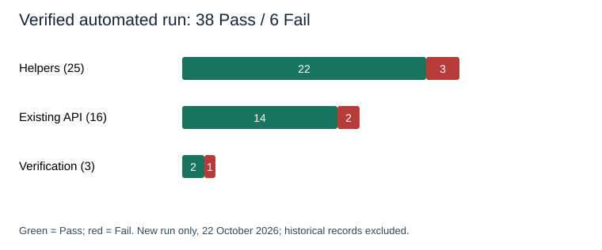
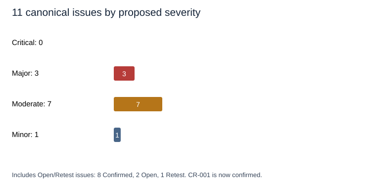

# Final Integrated QA Evaluation

PyTodo Pro | Weeks 1–8 evidence consolidated 22 October 2026

## Overall assessment

The evidence supports successful execution of common account/task workflows and good responsiveness within the small local workload tested. It also identifies persistent boundary, validation, query-handling, accessibility and feedback problems. Product acceptance should be withheld: the new isolated two-account test confirms that one user can delete another user’s task, alongside persistent validation and boundary failures. Testing does not establish that the application is defect-free.

## Method and evidence

The investigation progressed from black-box design to helper coverage, GUI/configuration/accessibility checks, web/API comparison, controlled security/performance work and API regression automation. Source_Records.md preserves workbook cells. Master_Test_Cases.md distinguishes project-week IDs. Defect_Log.md merges repeated issues by behaviour rather than counting every weekly alias as a new defect. Historical execution and the new 44-test automated verification run are kept separate. Evidence is packaged under evidence/. The original weekly workbooks are unchanged.

## Metrics

| Week | Population | Applicable planned | Assessed Pass+Fail | Pass | Fail | Blocked | Not Run | N/A | Assessment rate | Pass rate |
|---|---|---|---|---|---|---|---|---|---|---|
| 1 | Black-box | 84 | 84 | 78 | 6 | 0 | 0 | 0 | 100.0% | 92.9% |
| 2 | White-box case records | 23 | 23 | 20 | 3 | 0 | 0 | 0 | 100.0% | 87.0% |
| 3 | GUI / compatibility / usability / accessibility | 25 | 25 | 21 | 4 | 0 | 0 | 1 | 100.0% | 84.0% |
| 4 | Web / API / comparisons | 36 | 36 | 33 | 3 | 0 | 0 | 0 | 100.0% | 91.7% |
| 5 | Security assessments (includes reused evidence) | 8 | 8 | 5 | 3 | 0 | 0 | 2 | 100.0% | 62.5% |
| 6 | Automation mapping rows | 15 | 15 | 13 | 2 | 0 | 0 | 0 | 100.0% | 86.7% |

These populations overlap and must not be added to claim a distinct-test total. Week 3 assessment counts exclude administrative checklist completion and use the dedicated accessibility review. Week 5 includes four explicitly reused evidence records. See Execution_Status.md for the 23-versus-25 helper case reconciliation and 15 mappings versus 16 executed API tests.

Executed suite evidence: Historical Week 2 helpers 25 tests, 22 passed, 3 failed (88.0% pass). Supplied Week 6 pytest log 16 tests, 14 passed, 2 failed (87.5% pass). Focused regression register 10 entries, 8 passed and 2 failed (80.0% pass). These are separate views, not additive runs.

The chart shows only the new run; the preceding historical weekly table is a separate evidence population.

## Current verified execution and evidence qualification

Run date: 22 October 2026. Environment: Python 3.12.14, Flask 3.0.3, pytest 9.1.1, pytest-cov 7.1.0, coverage 7.16.2; exact environment and command are included in the verification evidence. Per-test temporary SQLite databases prevent use of original data. The copied application baseline remained unchanged according to its SHA-256 manifest.

| Suite | Planned | Executed | Pass | Fail | Blocked | Not Run | Pass rate |
|---|---:|---:|---:|---:|---:|---:|---:|
| Helpers | 25 | 25 | 22 | 3 | 0 | 0 | 88.0% |
| Existing API automation | 16 | 16 | 14 | 2 | 0 | 0 | 87.5% |
| Week 7 verification | 3 | 3 | 2 | 1 | 0 | 0 | 66.7% |
| New run total | 44 | 44 | 38 | 6 | 0 | 0 | 86.4% |

The historical Week 1 source still records 78 Pass / 6 Fail, but two cross-user Pass claims are unverified on their recorded observations. Treat that historical population as 76 unchallenged Pass claims, 6 Fail and 2 requiring retest for evidence-review purposes; this does not create a new Week 1 execution. Current cross-user verification is recorded separately. Week 4 UI/API agreement on due-today classification does not establish business correctness; both paths can agree on an incorrect value.

The 198 master records include supplemental historical functions and overlapping mappings. They are not 198 independent executions in this run. Historical security checks reuse earlier evidence. Do not add historical rows and current run counts into a unique executed-test total.

[Full verification log](evidence/verification_2026_10_22/pytest_full_log.txt), [individual results](evidence/verification_2026_10_22/results.xml), [coverage](evidence/verification_2026_10_22/coverage.json), and [baseline hashes](evidence/application_sha256.json) support the current results.

## Defect analysis

| Proposed severity | Canonical issues |
|---|---|
| Critical | 0 |
| Major | 3 |
| Moderate | 7 |
| Minor | 1 |

| Feature/module | Canonical issues |
|---|---|
| API authentication | 1 |
| Accessibility | 1 |
| Dashboard / helper | 1 |
| GUI feedback | 1 |
| Registration | 2 |
| Task API validation | 1 |
| Task creation | 1 |
| Task API ownership / deletion | 1 |
| Task search | 1 |
| Urgency | 1 |

There are 11 canonical recorded issues after verification: eight Confirmed, two Open and one Retest; none is Closed. The original ten issues remain, and CR-001 adds one confirmed Major/High ownership defect. Severity/priority remain proposed triage decisions pending group approval. D-005 is a historical, disputed authentication observation, not a currently reproduced vulnerability. The severity distribution uses proposed consistent Week 7 triage, not the inconsistent labels from earlier sheets. Duplicate registration, urgency and category validation recur across weeks; repeated discovery strengthens concern but does not increase unique defect count.

## Coverage and automation interpretation

The new verified run executes all 44 functions in the three included automated suites. It reproduces five known defects and confirms CR-001. The helper suite has 25 tests (22 Pass / 3 Fail), the existing API suite has 16 (14 Pass / 2 Fail), and the Week 7 verification suite has 3 (2 Pass / 1 Fail). Overall pass rate is 38/44 = 86.4%; failure rate is 6/44 = 13.6%. All 44 planned automated functions ran; none was blocked, skipped or not run. This execution rate applies only to these suites, not the entire manual baseline.

| Module | Statements covered | Statement coverage | Branches covered | Branch coverage | Combined coverage.py measure |
|---|---|---|---|---|---|
| helpers.py | 31/31 | 100.0% | 18/18 | 100.0% | 100.0% |
| app.py | 181/299 | 60.5% | 28/64 | 43.8% | 57.6% |
| Combined measured Python files | 212/330 | 64.2% | 46/82 | 56.1% | 62.6% |

The combined coverage.py measure divides covered statements plus covered branch exits by total statements plus branch exits. It differs from statement coverage alone. Helpers reach 100% structural coverage while three assertions fail: exercised code is not necessarily correct. The app.py gaps include substantial web-route behaviour; templates, CSS and real browser behaviour are outside these Python coverage figures.

Automation benefits include repeatable isolated validation, authentication, CRUD and regression checks. AUTO-08 and AUTO-14 refer to one function, so workbook rows are not a count of distinct functions. The new verification cases add fresh-client authentication and two-account GET/DELETE checks. The completion-exactly-now test still needs a reviewed business oracle: an implementation-oriented expectation should not be mistaken for an approved requirement.

## API, usability, compatibility and security findings

Week 4 records 13 web scenarios (12 Pass / 1 Fail) and 18 API tests (16 Pass / 2 Fail), plus five UI/API comparisons reported separately. Duplicate registration, invalid category acceptance and SQL-like search failure recur in later records. Whitespace-only web title acceptance is distinct from authenticated API blank-title rejection; empty browser-required fields also differ from whitespace server-side validation.

Week 3 indicates successful basic Chrome/Edge navigation and readable 800 px layout. Its historical Edge version/exact resolution remain unverified despite a populated matrix resolution field. A new 23 October 2026 evidence run used Microsoft Edge 155.0.4283.62 with a 1920x1080 display and viewport. It directly reproduced whitespace-title acceptance and the absence of a task-creation success message. The accessibility screenshot confirms separate labels without programmatic association. The review did not establish full WCAG compliance: contrast was visually assessed, no screen-reader run is supplied, and zoom evidence reaches only 125%. Slight heading alignment is an observation rather than an additional canonical defect.

The new run confirms unauthenticated task requests receive HTTP 401 and cross-user GET is denied. It also confirms CR-001: User B successfully deletes User A’s disposable task (HTTP 200), and User A’s subsequent GET returns HTTP 404. Code inspection shows DELETE is scoped by task ID without a user ownership predicate. This is a reproduced access-control defect, not merely an unexecuted risk. The historical Week 1 API-11/API-12 Pass observations remain unsupported; current evidence establishes GET protection and DELETE failure on the identified source snapshot. Search input is directly inserted into a SQL pattern; the recorded 500 is confirmed, while successful extraction/bypass is not claimed. No administrator/audit-history feature was identified, so related rows are N/A or limitations, not functional failures. For future testing, a completion timestamp equal to the evaluation time should count as within the last N days; the historical contrary test oracle is preserved but identified as superseded.

## Controlled performance evaluation

| Workload | Task GET requests | Duration | Average ms | p95 ms | GET throughput req/s | GET failures |
|---|---|---|---|---|---|---|
| Manual sequential | 10 | 97 s | Not recorded | N/A | 10/97 = 0.103 | 0 |
| 2 Locust users | 41 | 30 s | 10.26 | 16 | 41/30 = 1.37 | 0 |
| 5 Locust users | 97 | 30 s | 10.82 | 15 | 97/30 = 3.23 | 0 |

The inspected PERF-03 screenshot includes five login requests in addition to 97 task GETs: 102 aggregate requests. Its current RPS (3.4) is not the same measure as 97/30 experiment-average GET throughput. Its aggregate p95 is 23 ms while GET p95 is 15 ms. Do not mix endpoint and aggregate metrics. Average GET latency increased slightly while p95 decreased by 1 ms; the small sample and uncontrolled local conditions do not establish improved performance or scalability. Manual elapsed time may include client pacing and is not comparable directly with server request latency. No response-time SLA was specified, so these are observations rather than an acceptance pass.

## Residual risks and next tests

| Risk | Priority | Evidence / gap | Next action |
|---|---|---|---|
| Cross-user deletion | High | CR-001 confirmed: B DELETE 200, A GET 404 | Require ownership checks in authorised development; retain failing regression and verify denial plus task survival after correction |
| Identity and inconsistent categories | High | D-002 / D-009 remain in regression failures | After authorised developer fixes, retest both UI/API and database integrity |
| Unsafe search / unhandled inputs | High | D-010; incomplete malformed-type/date coverage | Parameterised-query review and negative tests on all input paths |
| Authentication history conflict | High | Current clean-client test passes with 401; historical build/session unknown | Preserve D-005 in Retest; compare historical build/session evidence if recoverable rather than claiming a fix |
| Date/count correctness | Medium | D-004 / D-006; exactly-now oracle unclear | Agree boundaries and retest with injected clock |
| Accessibility coverage | Medium | Labels defect; no screen reader or measured contrast | Screen-reader, contrast measurement, keyboard and larger zoom checks |
| Capacity and resilience | Medium | Only 2/5-user, 30-second local runs | Longer controlled staging load, dataset scaling and recovery checks |
| Evidence reproducibility | Medium | Versions, screenshots and case/log populations inconsistent | Capture build hash, environment, complete cases and raw output |

## Prevention and prioritised recommendations

First address ownership checks, username uniqueness, query parameterisation and category integrity through authorised development work; this assessment does not alter the application. Preserve failing regression tests and require passing evidence before closure. Next clarify date/password requirements and add boundary checks in review criteria. Add consistent server-side validation across UI and API paths. Improve labels and success feedback with manual assistive-technology verification.

Process prevention: review requirements and expected results before execution; use one canonical defect register; require peer review of data access and boundary conditions; add isolated regression checks to pull requests; capture JUnit and coverage artifacts for every build; discuss escaped defects and evidence gaps in retrospectives. Track high-priority defect closure, not only test pass rate. No defect-density or automation-coverage percentage is calculated because a suitable size denominator and deduplicated eligible manual baseline are absent.

## Limits and release decision

Recorded tests are a sample. No production topology, complete version history, independent full security assessment, endurance/recovery test or comprehensive accessibility audit is available. The study demonstrates useful QA evidence and unresolved risks, not a certified product. Proposed decision: continue educational testing and demonstration with disposable local data; do not recommend production release based on this evidence alone.

## Supplemental reconciliation

[Executed automation inventory](../07_Test_Management/Week%207/Executed_Automation_Inventory.md) resolves all 16 historical API functions and the two extra helper cases. The original weekly mappings remain preserved; use the supplement for function-level execution counts.

## Week 8 completion and remaining group actions

This report integrates execution metrics, severity/module analysis, coverage, API/UI/security/performance evidence, residual risks and prioritised prevention recommendations. Review the metrics CSV files and charts alongside the report. The four-member team is recorded in Week 7 (Team_and_Approval.md); the group approved the quality conclusion, severity/priority classifications and second-person reviews on 11 November 2026. The lecturer-confirmed deadline remains to be entered. Manual browser, accessibility and performance evidence is historical and has not been rerun. Week 9 presentation and standards contextualisation are separate deliverables.
